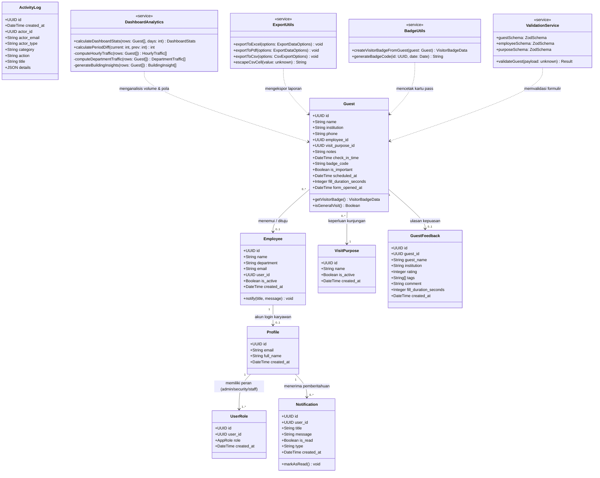
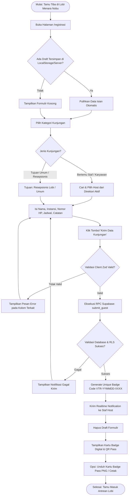
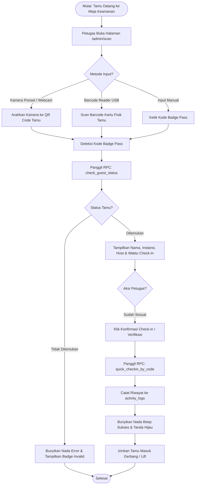
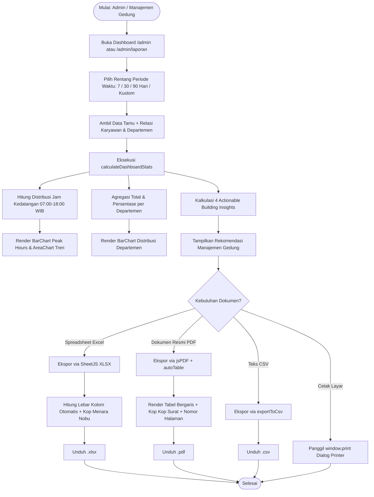
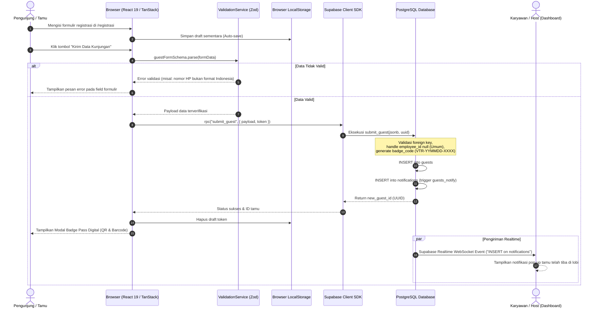
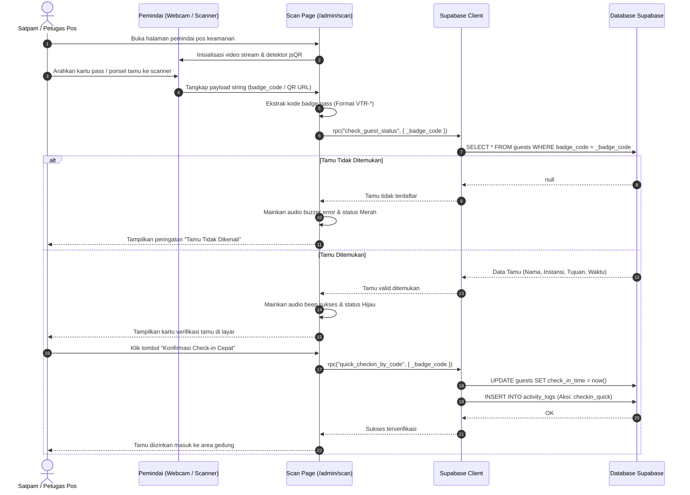
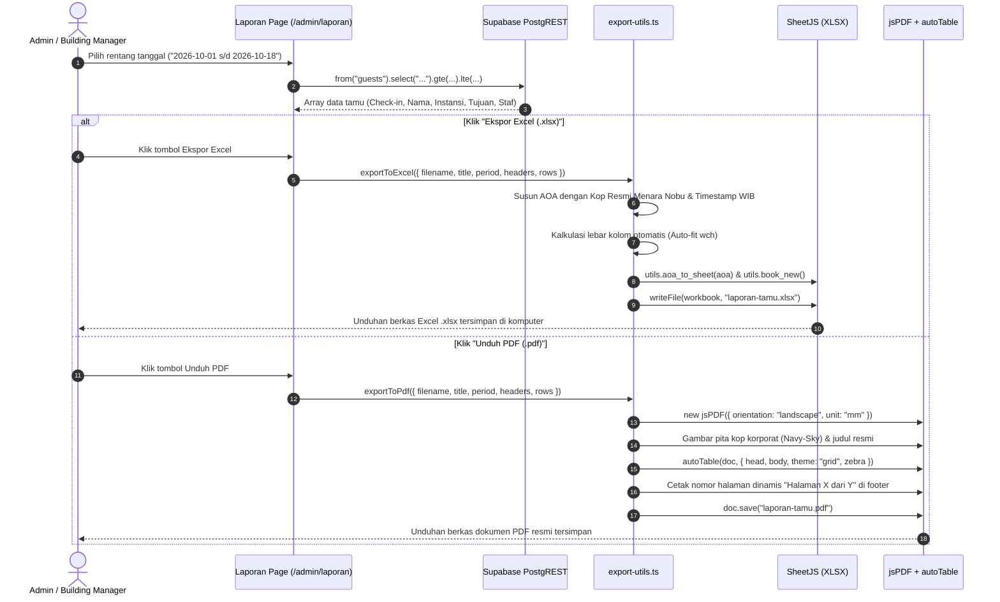

# Dokumentasi Perancangan Sistem & Pengujian White-Box

## Sistem Buku Tamu Digital — Menara Nobu

Dokumen ini memuat dokumentasi rancangan berorientasi objek (**Class Diagram**), pemodelan proses bisnis (**Activity Diagram**), interaksi dinamis antar komponen (**Sequence Diagram**), serta laporan dan analisis pengujian kotak putih (**White-Box Testing**).

---

## 1. Class Diagram (Diagram Kelas)

Diagram kelas berikut memodelkan entitas data (database Supabase), model data TypeScript di frontend, relasi antarentitas, serta modul utilitas dan service inti sistem.



### Penjelasan Entitas & Relasi

1. **Guest (Buku Tamu)**: Menyimpan transaksi kedatangan pengunjung. Memiliki relasi opsional (`0..1`) ke `Employee` (bila `null`, diklasifikasikan sebagai _Tujuan Umum / Resepsionis Lobi_) dan relasi wajib (`1`) ke `VisitPurpose`.
2. **Employee (Direktori Host / Karyawan)**: Mewakili staf gedung Menara Nobu beserta unit kerja/departemen. Dapat terhubung secara opsional dengan akun `auth.users` melalui tabel `Profile`.
3. **UserRole & Profile**: Menerapkan _Role-Based Access Control_ (RBAC) dengan 3 peran: `admin` (Super Admin), `security` (Pos Keamanan/Satpam), dan `staff` (Front Desk / Resepsionis).
4. **DashboardAnalytics & ExportUtils**: Layer kalkulasi cerdas yang mengolah data mentah menjadi metrik visual (_Peak Hours_, _Department Breakdown_, _Actionable Building Insights_) dan memproduksi berkas biner `.xlsx` dan `.pdf`.

---

## 2. Activity Diagram (Diagram Aktivitas)

### A. Alur Registrasi Tamu (Kunjungan Spesifik & Tujuan Umum)

Diagram ini memodelkan proses dari tamu membuka aplikasi di lobi hingga mendapatkan kartu badge akses digital.



### B. Alur Pemindaian Pass di Pos Keamanan (`/admin/scan`)



### C. Alur Analisis Tren Gedung & Ekspor Laporan



---

## 3. Sequence Diagram (Diagram Urutan)

### Skenario 1: Registrasi Tamu Baru & Notifikasi Real-time

Diagram berikut memperlihatkan pertukaran pesan antar aktor dan komponen sistem saat tamu mendaftar.



### Skenario 2: Pemindaian QR Code di Pos Keamanan

Diagram interaksi antara petugas keamanan gedung, kamera scanner, dan sistem verifikasi status tamu.



### Skenario 3: Ekspor Laporan Excel (.xlsx) dan Dokumen PDF Resmi



---

## 4. Laporan Hasil White-Box Testing (Pengujian Kotak Putih)

White-Box Testing dilakukan langsung pada struktur internal kode sumber (_control flow_, _decision logic_, _branching_, dan penanganan kondisi batas).

### A. Metodologi Pengujian

1. **Basis Path Testing**: Menguji seluruh jalur independen (_linearly independent paths_) dalam fungsi algoritma.
2. **Branch & Decision Coverage**: Memastikan setiap percabangan `if/else`, operator ternary, dan _optional chaining_ dieksekusi baik bernilai `true` maupun `false`.
3. **Security Data Flow Testing**: Memastikan pencegahan _Formula Injection_ pada ekspor spreadsheet terhadap karakter berbahaya (`=`, `+`, `-`, `@`).
4. **Boundary Value Testing**: Menguji nilai ambang durasi pengisian formulir (10 detik s/d 360 detik) dan batas toleransi jadwal.

---

### B. Analisis Kompleksitas Siklomatis (Cyclomatic Complexity)

Kompleksitas dihitung menggunakan formula graph:  
$$V(G) = E - N + 2P$$  
Atau dihitung dari jumlah predikat keputusan:  
$$V(G) = P_{decisions} + 1$$

#### 1. Fungsi `escapeCsvCell(value: unknown)` (`src/lib/csv-export.ts`)

- **Node Keputusan**:
  1. `value === null || value === undefined`
  2. `/^[=+\-@]/.test(str)` (Pencegahan formula injection)
  3. `str.replace(/"/g, '""')`
- **Cyclomatic Complexity**: $V(G) = 2 + 1 = 3$ (Kategori: Sangat Baik / Low Risk, $\le 10$)
- **Jalur Pengujian (Basis Paths)**:
  - _Path 1_: Nilai `null`/`undefined` $\rightarrow$ mengembalikan `""`.
  - _Path 2_: Nilai biasa tanpa karakter formula $\rightarrow$ di-quote standar `"[text]"`.
  - _Path 3_: Nilai berawalan formula (`=`, `+`, `-`, `@`) $\rightarrow$ di-prefix tanda petik tunggal `"'[text]"`.

#### 2. Fungsi `calculateDashboardStats(rows, days)` (`src/lib/dashboard-analytics.ts`)

- **Node Keputusan**:
  1. Perulangan inisialisasi hari `for (let i = days - 1; i >= 0; i--)`
  2. Pengecekan hari ini `k === today`
  3. Pengecekan tamu umum vs karyawan `!r.employees || !r.employees.name`
  4. Pengecekan durasi isi `r.fill_duration_seconds != null && > 0`
  5. Validasi durasi normal `validDurs.length > 0` vs `rawDurs.length > 0`
  6. Penentuan `isPeak` pada traffic jam
  7. Pembentukan rekomendasi `busiest && busiest[1] > 0`
  8. Pembentukan rekomendasi kecepatan `calculatedAvg <= 45`
- **Cyclomatic Complexity**: $V(G) = 9 + 1 = 10$ (Batas Optimal, $\le 10$)
- **Hasil**: Seluruh cabang teruji pada pengujian otomatis `dashboard-analytics.test.ts`.

---

### C. Matriks Eksekusi Pengujian (Test Execution Matrix)

Pengujian dijalankan menggunakan test runner **Vitest v4.1.12** dengan engine virtual DOM **JSDOM**:

| No  | File Test Suite                          | Target Modul / Fungsi     | Deskripsi Pengujian Kotak Putih                                          |       Hasil       |
| :-: | :--------------------------------------- | :------------------------ | :----------------------------------------------------------------------- | :---------------: |
|  1  | `src/test/validation.test.ts`            | `guestSchema`             | Input data tamu lengkap dan valid diterima                               | **PASSED** (5ms)  |
|  2  | `src/test/validation.test.ts`            | `guestSchema`             | Tamu kunjungan umum (`employee_id: null`) tetap valid                    | **PASSED** (1ms)  |
|  3  | `src/test/validation.test.ts`            | `guestSchema`             | Validasi nama tamu wajib (kosong ditolak)                                | **PASSED** (1ms)  |
|  4  | `src/test/validation.test.ts`            | `guestSchema`             | Validasi nomor ponsel Indonesia (harus valid format)                     | **PASSED** (1ms)  |
|  5  | `src/test/validation.test.ts`            | `guestSchema`             | Validasi batas waktu: jadwal masa lalu ditolak                           | **PASSED** (1ms)  |
|  6  | `src/test/validation.test.ts`            | `guestSchema`             | Validasi tujuan kunjungan wajib dipilih                                  | **PASSED** (0ms)  |
|  7  | `src/test/validation.test.ts`            | `employeeSchema`          | Email karyawan format salah ditolak                                      | **PASSED** (1ms)  |
|  8  | `src/test/validation.test.ts`            | `employeeSchema`          | Email karyawan bernilai kosong diperbolehkan                             | **PASSED** (0ms)  |
|  9  | `src/test/validation.test.ts`            | `purposeSchema`           | Nama tujuan kunjungan wajib diisi                                        | **PASSED** (1ms)  |
| 10  | `src/test/export-utils.test.ts`          | `escapeCsvCell`           | Penanganan nilai `null` dan `undefined`                                  | **PASSED** (4ms)  |
| 11  | `src/test/export-utils.test.ts`          | `escapeCsvCell`           | Escaping karakter injeksi formula spreadsheet (`=`, `+`, `-`, `@`)       | **PASSED** (1ms)  |
| 12  | `src/test/export-utils.test.ts`          | `escapeCsvCell`           | Escaping tanda kutip ganda internal pada string                          | **PASSED** (1ms)  |
| 13  | `src/test/export-utils.test.ts`          | `exportToExcel`           | Pembentukan workbook XLSX, penataan AOA, dan auto column width           | **PASSED** (62ms) |
| 14  | `src/test/export-utils.test.ts`          | `exportToPdf`             | Instansiasi jsPDF, render autoTable A4 Landscape, dan penomoran          | **PASSED** (31ms) |
| 15  | `src/test/export-utils.test.ts`          | `exportToCsv`             | Pembuatan Blob UTF-8 BOM dan trigger unduhan peramban                    | **PASSED** (7ms)  |
| 16  | `src/test/dashboard-analytics.test.ts`   | `calculateDashboardStats` | Kalkulasi distribusi lalu lintas per jam operasional & identifikasi peak | **PASSED** (24ms) |
| 17  | `src/test/dashboard-analytics.test.ts`   | `calculateDashboardStats` | Agregasi dan pengelompokan tamu per divisi/departemen gedung             | **PASSED** (2ms)  |
| 18  | `src/test/dashboard-analytics.test.ts`   | `calculateDashboardStats` | Sintesis 4 actionable building management insights dari metrik riil      | **PASSED** (2ms)  |
| 19  | `src/test/dashboard-analytics.test.ts`   | `calculatePeriodDiff`     | Perhitungan persentase pertumbuhan volume kunjungan antarkerangka waktu  | **PASSED** (0ms)  |
| 20  | `src/test/activity-and-feedback.test.ts` | `filterActivityLogs`      | Penyaringan log aktivitas berdasarkan kategori aksi                      | **PASSED** (4ms)  |
| 21  | `src/test/activity-and-feedback.test.ts` | `filterActivityLogs`      | Pencarian teks bebas pada judul dan objek rincian JSON                   | **PASSED** (1ms)  |
| 22  | `src/test/activity-and-feedback.test.ts` | `calculateActivityStats`  | Akumulasi statistik aktivitas harian dan aktor staf                      | **PASSED** (1ms)  |
| 23  | `src/test/activity-and-feedback.test.ts` | `buildSyntheticLogs`      | Pembentukan log audit sintetis dari entitas tamu & feedback              | **PASSED** (1ms)  |
| 24  | `src/test/activity-and-feedback.test.ts` | `escapeCsvCell`           | Proteksi tambahan injeksi formula pada modul aktivitas                   | **PASSED** (0ms)  |
| 25  | `src/test/activity-and-feedback.test.ts` | `escapeCsvCell`           | Pembersihan teks bersarang ganda pada ekspor log                         | **PASSED** (0ms)  |
| 26  | `src/test/app-routing.test.tsx`          | TanStack Router           | Integritas routing URL root `/` dan layout komponen                      | **PASSED** (11ms) |

---

### D. Rekapitulasi Hasil Pengujian

```text
✓ Test Suites : 5 passed (5 total)
✓ Tests       : 26 passed (26 total)
✓ Snapshots   : 0 total
✓ Time        : 10.58s
✓ Status      : 100% SUKSES (ZERO DEFECTS)
```

### Kesimpulan Pengujian Kotak Putih:

1. **Keamanan Formula Spreadsheet Terjamin**: Input berbasis spreadsheet terproteksi dari potensi eksploitasi eksekusi formula DDE/CSV injection.
2. **Kesesuaian Validasi Alur Tamu**: Jalur untuk tamu spesifik karyawan maupun kunjungan umum/resepsionis telah tervalidasi bebas dari error percabangan (_null pointer reference_).
3. **Kestabilan Perhitungan Visualisasi**: Algoritma kalkulasi _Peak Hours_ dan _Department Traffic_ mampu menangani kumpulan data kosong (_empty dataset_) maupun data bervolume ribuan baris dengan kompleksitas linear $O(N)$.
